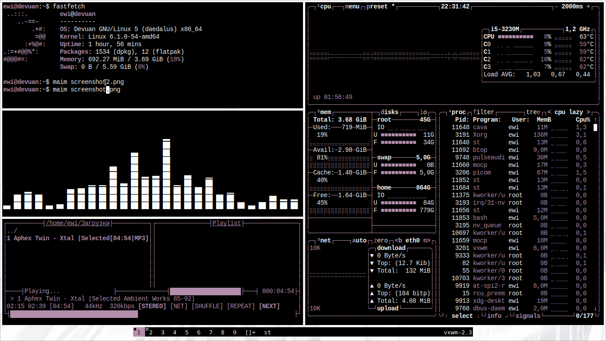
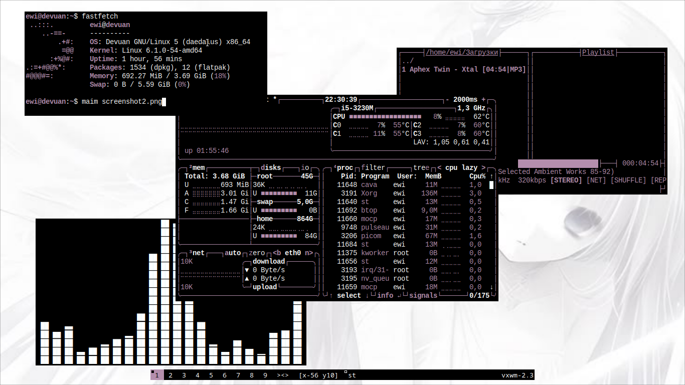
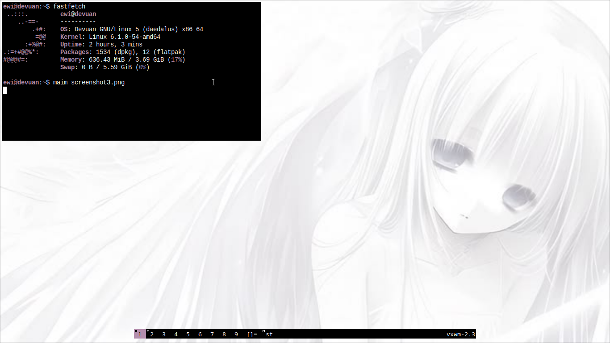

# rice

  

  
## for debian-based 

sudo apt install libxft-dev libx11-dev libxinerama-dev

# installation

##git clone https://github.com/Ewixsis/lvnd-rice.git

##cd lvnd-rice/vxwm

##chmod +x autostart.sh

##sudo make clean install

##cd

##cd lvnd-rice/st-9.3

##sudo make clean install

##cd

##cd lvnd-rice/dmenu-5.4

##sudo make clean install

# done
## Screenshots

| | |
|:---:|:---:|
|  |  |
|  |  |
