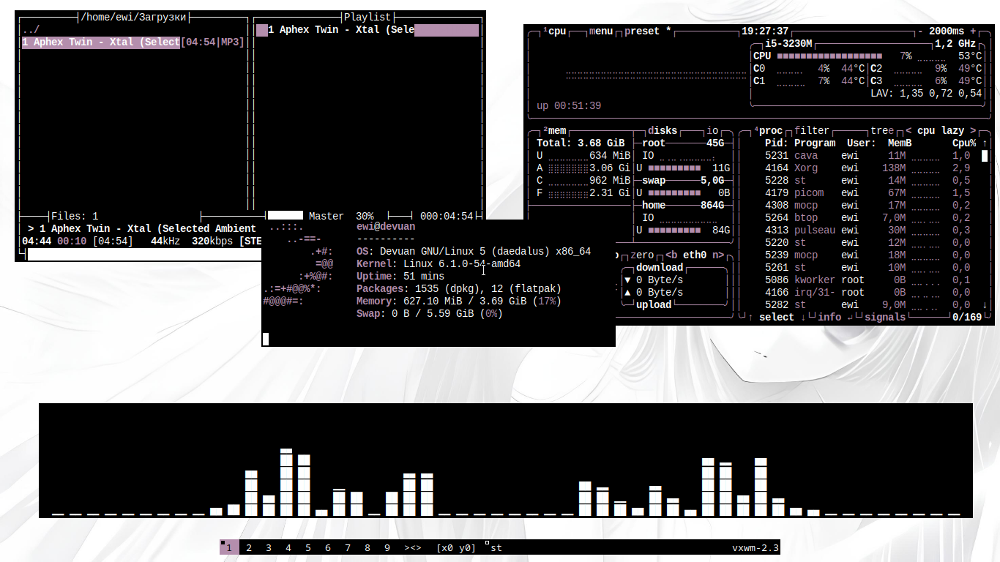

# screenshot

  

# installation

git clone https://github.com/Ewixsis/lvnd-rice.git

cd lvnd-rice/vxwm

chmod +x autostart.sh

sudo make clean install

cd

cd lvnd-rice/st-9.3

sudo make clean install

cd

cd lvnd-rice/dmenu-5.4

sudo make clean install

# done

  

